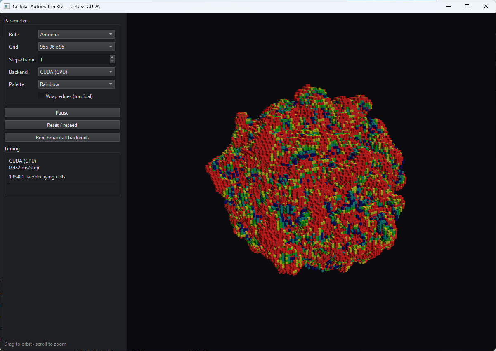

# Cellular Automaton 3D — CPU vs CUDA

A real-time **3D cellular automaton** built with **Qt 6 (C++23)** and **OpenGL**,
computed on three back-ends so you can compare their performance live:

- **CPU (single-threaded)** — baseline
- **CPU (multi-threaded)** — the same passes spread over z-planes by a persistent
  pool of `std::jthread` workers
- **CUDA (GPU)** — one thread per cell

The living cells are rendered as **instanced cubes** in an OpenGL 3.3 core-profile
viewport with an orbit camera and simple lighting. Decaying cells fade through a
color gradient, producing coral- and crystal-like structures.



## What it demonstrates

- A **3D stencil** compute pattern (each cell depends on its 26 Moore neighbors),
  mapped onto the GPU with a 3D thread grid and onto the CPU as a separable sum.
- **Instanced 3D rendering**: one cube mesh drawn thousands of times with a
  4-byte per-instance position + state record, so hundreds of thousands of live
  cells render in a single draw call.
- The same CPU-vs-GPU methodology as the rest of the series, on a workload that is
  both compute- and memory-touching.

## Rules

Uses the state-decay "life-like" model over the 26-cell Moore neighborhood, in
the survive / birth / states notation: a cell value of *states* − 1 means alive,
0 means dead, and everything in between is decaying. Only alive cells count as
neighbors. Included presets:

- **445** — survive 4, birth 4, 5 states (sparse, drifting clusters)
- **Pyroclastic** — survive 4–7, birth 6–8, 10 states
- **Amoeba** — survive 9–26, birth {5–7,12,13,15}, 5 states
- **Clouds** — survive 13–26, birth {13,14,17–19}, 2 states
- **Crystal** — survive 5–8, birth {1,3}, 5 states

A cell that stops surviving does not die instantly; it decays through the
intermediate states, which is what creates the shells and trails. With 2 states
there is nothing in between, so Clouds cells die at once.

445 and, on the smaller grids, Clouds need **wrap-around edges** (on by default);
with dead edges they usually die out.

## Features

- Switchable rule presets and grid size (32³ / 48³ / 64³ / 96³)
- Adjustable steps-per-frame
- Wrap-around (toroidal) or dead edges
- Five color palettes
- Drag to orbit, scroll to zoom
- Play / Pause / Reset (reseed)
- **Benchmark all backends** — advances a fixed batch on each back-end from the
  same starting grid, after one warm-up step, and reports ms-per-step plus
  speedup vs single-threaded CPU

## Requirements

- **Qt 6.4+** (Widgets, OpenGL, OpenGLWidgets modules)
- **CMake 3.26+**
- A C++23 compiler (MSVC 2022 / GCC 13+ / Clang 18+)
- An OpenGL 3.3-capable GPU (basically anything modern)
- For the CUDA back-end: **NVIDIA CUDA Toolkit 12.0+** (the device code is C++20)
  and an NVIDIA GPU. Without the toolkit, build with `-DUSE_CUDA=OFF`; without a
  GPU at run time the CUDA option simply does not appear.

## Building (Windows, with CUDA)

CUDA on Windows requires the **MSVC** host compiler, so use a Qt build for MSVC
(e.g. `C:\Qt\6.x.x\msvc2022_64`).

```powershell
cmake -B build -S . -A x64 -DCMAKE_PREFIX_PATH="C:/Qt/6.x.x/msvc2022_64" -DUSE_CUDA=ON -DCUDA_ARCH=89
cmake --build build --config Release
```

Or set your Qt path in `CMakePresets.json` and use the presets, which also
produce `build\CellularAutomaton3D.sln`:

```powershell
cmake --preset vs2022-cuda
cmake --build --preset cuda-release
```

## Building without CUDA (CPU only — e.g. macOS)

```bash
cmake -B build -S . -DUSE_CUDA=OFF -DCMAKE_PREFIX_PATH="/path/to/Qt/6.x.x/<kit>"
cmake --build build
```

## Implementation notes

- `CARule.h` is Qt-free and compiles under both a normal C++ compiler and nvcc.
  The `CA_HD` macro shares one rule implementation between the CPU and the GPU;
  the two differ only in how they count neighbors.
- **CPU**: the 3×3×3 neighbor count is separable, so each step is two passes over
  the z-planes — 3×3 block sums inside every plane, then three planes added per
  cell and the next state read from a small transition table built from the
  shared rule. Both passes are plain byte loops without branches.
- **GPU**: one thread per cell reads its 26 neighbors directly, with a
  check-free path for cells that do not touch a grid face.
- The grid state is authoritative on the host; the CUDA back-end uploads it,
  iterates on the device (ping-pong buffers, no per-step copies), and downloads
  the result. The reported time is the honest wall time for a batch of steps.
  If CUDA fails at run time, the multi-threaded CPU takes over and the error is
  shown in the timing panel.
- Rendering is decoupled from simulation: after each batch the host scans the
  grid and uploads a compact instance buffer (4 bytes per live cell) to the GPU.
- `CudaAutomatonStub.cpp` replaces `CudaAutomaton.cu` in CPU-only builds, so the
  rest of the code has no `#ifdef`s.

## Possible improvements

- **CUDA–OpenGL interop**: keep the grid on the GPU and generate the instance
  buffer on the device, removing the per-frame host readback entirely.
- Shared-memory tiling of the 3D stencil (load a tile plus halo per block).
- Marching cubes for a smooth iso-surface instead of discrete voxels.
- Paint/erase cells directly in the 3D view.

## License

MIT — do whatever you like, no warranty.

## Support

If you found this project interesting or useful, you can support my work:

[](https://github.com/sponsors/makarov-mm)
